<div align="center">



<br>

**Unified Developer Environment Guardian &amp; Performance Auditor**

Comprehensive audit framework for Node.js/TypeScript projects. It finds security vulnerabilities,
performance issues, architecture violations and configuration problems, and tells you how to fix them.

<!-- AUTO:badges:start -->
[](https://www.typescriptlang.org/)
[](https://nodejs.org/)
[](https://vitest.dev)
[](https://github.com/Muraqib-Core/muraqib/actions/workflows/ci.yml)
[](LICENSE)
<!-- AUTO:badges:end -->


<br>

[🚀 Quick start](#-quick-start) &nbsp;·&nbsp; [🎬 Video](#-see-it-in-action) &nbsp;·&nbsp; [🔎 Key features](#-key-features) &nbsp;·&nbsp; [🔌 Workflow](#-fits-where-you-work) &nbsp;·&nbsp; [📟 CLI](docs/cli.md) &nbsp;·&nbsp; [📖 Docs](#-documentation) &nbsp;·&nbsp; [🌙 العربية](#arabic)

</div>


<p align="center"></p>

## 🎬 See it in action

<p align="center">
  <a href="docs/assets/muraqib-promo.mp4" title="Watch the full video">
    
  </a>
</p>

<p align="center">
  <a href="docs/assets/muraqib-promo.mp4"><b>▶ Watch the full 65-second video</b></a> <sub>(1080p, no sound needed)</sub>
</p>

<!--
  Want the video to play right here, inline, with controls? GitHub only does that for files
  uploaded through its own editor. Edit this README on github.com, drag docs/assets/muraqib-promo.mp4
  into the editor, and GitHub inserts a https://github.com/user-attachments/assets/... link on its own
  line. Paste that line in place of the GIF block above.
-->

<p align="center"></p>


## 🧭 Why Muraqib

<p align="center">
  
</p>

AI assistants write code in seconds. They also hard-code a key, concatenate a query, or forget an `await`, and the
code still runs. **Muraqib** (Arabic *مراقب*, "the one who watches") is the second pair of eyes: it audits your project and
reports what an assistant, or a tired human, missed, in a form both people and tools can act on.

| Principle | In practice |
|-----------|-------------|
| 🤝 **Complementary** | Built to sit beside AI coding tools and check their output, not to replace them. |
| 🎯 **Actionable** | Every finding carries a severity, a file and line, and a recommended fix. |
| 🤖 **Machine-readable** | The agent report is versioned JSON with stable issue ids, so an agent can confirm a fix by re-running. |
| 🛟 **Safe by design** | Git hooks fail open and never trap a commit; secrets are masked in output and redacted before any AI request. |

<p align="center"></p>


## 🚀 Quick start

```bash
npx @muraqib/core audit        # audit the current project
npx @muraqib/core audit -i     # guided, interactive mode
```

<p align="center">
  
</p>

> Illustrative output (a real run of `muraqib audit` on this repository). Install, flags and CI setup are in [Installation](docs/install.md), [CLI usage](docs/cli.md) and [CI/CD](docs/ci.md).

Install locally with `npm install -D @muraqib/core`, then run `npx muraqib audit`. In CI, pass `--no-interactive`
(and `--fail-on-warning` when warnings should block the build). Details, optional peer dependencies and local
development are in [docs/install.md](docs/install.md) and [docs/development.md](docs/development.md).

<p align="center"></p>

## 🔎 Key features

<p align="center">
  
</p>

- 🔐 **Security:** injection prevention, secret detection, auth/crypto validation, security header analysis.
- ⚡ **Performance:** memory, bundle budget (14 KB default), network latency, dead code, dependencies, async patterns, caching, images, render blocking, HTTP/2.
- 🏗️ **Architecture:** configuration validation, Docker best practices, compatibility checking, AI-powered recommendations.
- 🤖 **AI integration:** AI-complementary checks, advanced secret detection, intelligent fix suggestions, agent-ready JSON reports ([AI agents](docs/ai.md), [Agent v2](docs/agent-v2.md)).

The full list of checks and the guard architecture are in [docs/guards.md](docs/guards.md).

<p align="center"></p>

## 🔌 Fits where you work

<p align="center">
  
</p>

| Stage | Command | What happens |
|-------|---------|--------------|
| **Write** | `muraqib agent -p . --osv` | Your assistant gets a deterministic JSON report: issues sorted by severity, stable ids, no timestamps. |
| **Commit** | `muraqib hook install` | The pre-commit hook scans only the lines you stage and blocks credentials that are almost certainly real. |
| **Review** | `muraqib audit --report -o "$GITHUB_STEP_SUMMARY"` | A Markdown scorecard lands in the CI job summary; add `--fail-on-warning` to gate on warnings. |
| **Ship** | `muraqib audit --no-interactive` | Exit code `0` means nothing blocks the build; `1` means blocking findings; `3` means a scanner failed. |

```yaml
# .github/workflows/audit.yml (excerpt)
- name: Muraqib audit
  run: npx @muraqib/core audit --no-interactive --report -o "$GITHUB_STEP_SUMMARY"
```

Prefer the editor? The [VS Code extension](extension/README.md) runs the same engine, fills the **Problems** panel and
shows a status-bar counter. It never edits your code.

`muraqib audit --report` turns findings into a single **0–100 score** with a grade; the method is under
[Security scorecard](docs/cli.md#security-scorecard---report----format-md). More in [docs/ci.md](docs/ci.md).

<p align="center"></p>

<a id="arabic"></a>

<details>
<summary><b>🌙 بالعربية: ما هو مراقب؟</b></summary>

<br>

<div dir="rtl" align="right">

**مراقب** هو حارس بيئة التطوير. الذكاء الاصطناعي يكتب الشيفرة بسرعة، فمن يراجعها؟
مراقب أداة تدقيق لمشاريع Node.js وTypeScript، تفحص مشروعك وتخبرك بما فاتك وكيف تصلحه:

- 🔐 **الأمان:** الأسرار المكتوبة داخل الشيفرة، وحقن SQL وXSS، والمصادقة والتشفير، وترويسات HTTP الأمنية.
- ⚡ **الأداء:** الذاكرة، وحجم الحزمة، والأنماط غير المتزامنة، والشيفرة الميتة، وزمن الاستجابة.
- 🏗️ **البنية:** الإعدادات، وDocker، والتبعيات، والتوافق، والتحقق من متغيرات البيئة.
- 🤖 **جاهز للوكلاء:** تقارير JSON ومخططات أدوات تستطيع أدوات الذكاء الاصطناعي قراءتها.

يعمل في الطرفية، وفي خطافات Git قبل الإيداع، وفي أنظمة التكامل المستمر، وداخل VS Code.

</div>

```bash
npx @muraqib/core audit
```

<div dir="rtl" align="right">

**ثق بالشيفرة. وتحقّق منها على أي حال.**

</div>

</details>

<p align="center"></p>

## 📖 Documentation

> Facts such as versions, guards, CLI flags, scripts and workflows are **generated** from the source (`npm run docs:generate`). Blocks marked `<!-- AUTO:... -->` and `docs/REFERENCE.md` must not be edited by hand.

- [docs/install.md](docs/install.md) - Install from npm, optional peer dependencies
- [docs/cli.md](docs/cli.md) - CLI commands, options, scorecard, hooks, interactive mode, exit codes
- [docs/ai.md](docs/ai.md) - Using Muraqib from AI agents (Claude Code, Cursor, MCP clients)
- [docs/agent-v2.md](docs/agent-v2.md) - Agent v2: ranked plan, verified fixes, optional Gemini
- [docs/guards.md](docs/guards.md) - What it checks, BaseGuard architecture, built-in guards, API
- [docs/ci.md](docs/ci.md) - Workflow integration and the CI/CD pipeline
- [docs/development.md](docs/development.md) - Local development, scripts, tests, project structure, contributing
- [docs/webview.md](docs/webview.md) - Documentation web view
- [ARCHITECTURE.md](ARCHITECTURE.md) - Detailed architecture guide
- [API.md](API.md) - Complete API reference
- [docs/REFERENCE.md](docs/REFERENCE.md) - Generated reference (guards, public API, CLI, scripts, workflows)
- [CONTRIBUTING.md](CONTRIBUTING.md) - Contribution guidelines
- [CHANGELOG.md](CHANGELOG.md) - Version history

## 📄 License
ISC © [Aya Almadhon](https://github.com/Ayaalmadhon2004) & [Jenan](https://github.com/Jenan04)

## 💛 Acknowledgments
Built as an **AI-complementary DevTool** to enhance AI-generated code quality, security, and performance.

**Key Features:**
- ✅ Catches issues AI models may miss
- ✅ Provides structured, actionable recommendations
- ✅ Integrates with CI/CD pipelines
- ✅ TypeScript-first for type safety
- ✅ Extensible through custom guards

<p align="center">
  <a href="https://github.com/Muraqib-Core/muraqib"></a>
</p>
