# CI/CD and workflow integration

> Part of the [Muraqib documentation](../README.md). Workflow tables below are generated from `.github/workflows/`.

## 🔌 Fits where you work

<p align="center">
  
</p>

| Stage | Command | What happens |
|-------|---------|--------------|
| **Write** | `muraqib agent -p . --osv` | Your assistant gets a deterministic JSON report: issues sorted by severity, stable ids, no timestamps. |
| **Commit** | `muraqib hook install` | The pre-commit hook scans only the lines you stage and blocks credentials that are almost certainly real. |
| **Review** | `muraqib audit --report -o "$GITHUB_STEP_SUMMARY"` | A Markdown scorecard lands in the CI job summary; add `--fail-on-warning` to gate on warnings. |
| **Ship** | `muraqib audit --no-interactive` | Exit code `0` means nothing blocks the build; `1` means blocking findings; `3` means a scanner failed. |

```yaml
# .github/workflows/audit.yml (excerpt)
- name: Muraqib audit
  run: npx @muraqib/core audit --no-interactive --report -o "$GITHUB_STEP_SUMMARY"
```

Prefer the editor? The [VS Code extension](../extension/README.md) runs the same engine, fills the **Problems** panel and
shows a status-bar counter. It never edits your code.

### 📊 Know where you stand

<p align="center">
  
</p>

`muraqib audit --report` turns findings into a single **0–100 score** with a grade, broken down by severity and domain.
The score is a pure function of the findings, so the same report always yields the same number. The full method is under
[Security scorecard](cli.md#security-scorecard---report----format-md).

## 🔁 CI/CD Pipeline

Workflows (generated from `.github/workflows/`):

<!-- AUTO:workflows:start -->
| Workflow | File | Triggers | Jobs |
|----------|------|----------|------|
| agent-v2 on Windows | `.github/workflows/agent-v2-windows.yml` | pull_request | `windows` |
| Audit | `.github/workflows/audit.yml` | push, pull_request, workflow_dispatch | `audit` |
| CI/CD Pipeline | `.github/workflows/ci.yml` | push, pull_request | `lint-and-build`, `test-and-coverage`, `self-audit`, `extension`, `quality-gate`, `package-contents`, `docs-check`, `security-scan` |
| CodeQL | `.github/workflows/codeql.yml` | push, pull_request, schedule | `analyze` |
| Commit Identity | `.github/workflows/commit-identity.yml` | pull_request | `check-commit-identity` |
| Docs | `.github/workflows/docs.yml` | push, schedule, workflow_dispatch | `refresh` |
| Release VS Code extension | `.github/workflows/extension-release.yml` | push | `release` |
| Release | `.github/workflows/release.yml` | push | `release` |
<!-- AUTO:workflows:end -->

### `.github/workflows/ci.yml` jobs

<!-- AUTO:ci-jobs:start -->
- **Lint and Build** (`lint-and-build`) (matrix: node-version 20.12.0, 22.x)
- **Test and Coverage** (`test-and-coverage`)
- **Self-Audit (muraqib audit)** (`self-audit`)
- **VS Code extension** (`extension`)
- **Quality Gate** (`quality-gate`) - needs: `lint-and-build`, `test-and-coverage`, `self-audit`, `package-contents`, `security-scan`, `docs-check`, `extension`
- **Package Contents** (`package-contents`)
- **Generated Docs** (`docs-check`)
- **Security Scan** (`security-scan`)
<!-- AUTO:ci-jobs:end -->

Coverage thresholds (85%) are enforced by `vitest.config.ts`; the `docs-check` job fails a PR when generated documentation is stale, and the `Docs` workflow opens a refresh PR automatically after changes land on `main`/`develop`.

### Running Locally

```bash
# Verify CI passes locally
npm run type-check    # TypeScript strict check
npm run build         # Verify compilation
npm run lint          # ESLint validation
npm test              # Run all tests
npm run docs:check    # Generated docs are up to date
```
