# Guards and checks

> Part of the [Muraqib documentation](../README.md). The guard table below is generated; see [REFERENCE.md](REFERENCE.md) for the full generated reference.

## 🔎 What it checks

<p align="center">
  
</p>

### 🔐 Security Auditing
- **Injection Prevention**: SQL/XSS detection and prevention
- **Secret Detection**: API keys, passwords, tokens, credentials
- **Auth/Crypto Validation**: Security protocols and cryptographic best practices
- **Security Headers Analysis**: HTTP security header validation

### ⚡ Performance
- **Memory Management**: Heap leak detection and memory profile analysis
- **Bundle Optimization**: Size monitoring and budget enforcement (14 KB default)
- **Network Analysis**: Latency measurement and optimization recommendations
- **Dead Code Detection**: Unreachable code and unused exports
- **Dependency Analysis**: Circular dependencies and duplication detection
- **Async Patterns**: Floating promises and missing await validation
- **Cache Strategy**: Performance optimization and caching recommendations
- **Image Optimization**: Image size analysis and format recommendations
- **Render Blocking**: Render-blocking resource detection
- **HTTP/2 Support**: Protocol and compression optimization

### 🏗️ Architecture Validation
- **Configuration Validation**: Environment variables and config file validation
- **Docker Best Practices**: Containerization checks and recommendations
- **Compatibility Checking**: Node.js version and peer dependency validation
- **AI-Powered Recommendations**: Context-aware issue resolution suggestions

### 🤖 AI Integration
- **AI-Complementary**: Works with AI-generated code to catch issues
- **Secret Detection**: Advanced pattern matching for sensitive data
- **Intelligent Recommendations**: AI-powered fix suggestions

## 🏛️ Architecture Overview
### Core Components

#### BaseGuard (Abstract Base Class)
The foundation for all audit modules. Each guard specializes in one audit category:

```typescript
import { BaseGuard, AuditContext, AuditResult } from '@muraqib/core';

class CustomGuard extends BaseGuard {
  constructor(context?: AuditContext) {
    super('custom-guard', context);
  }

  async execute(): Promise<AuditResult> {
    // Implement audit logic
    const issue = this.createIssue(
      'CUSTOM_001',
      'warning',
      'Issue Title',
      'Issue description',
      { file: 'src/app.ts', line: 42 },
      'How to fix this'
    );
    
    return this.issues([issue], 'Found issues');
  }
}

const guard = new CustomGuard({ projectRoot: process.cwd() });
const result = await guard.run();
```

#### Built-in Guards

Generated from every class that `extends BaseGuard` (the purpose comes from its JSDoc):

<!-- AUTO:guards:start -->
| Guard | Source | Purpose |
|-------|--------|---------|
| `AsyncGuard` | `src/core/async-guard.ts` | Detects floating promises, missing `await`, and callback-hell patterns in source files. Severity levels used: warning, error. |
| `BundleBudgetGuard` | `src/rules/bundle-budget-guard.ts` | Checks source files against the 14 KB first-round-trip budget. Severity levels used: warning. A project with no measurable source files is reported as skipped, never as a pass. |
| `CachePerformanceGuard` | `src/core/performance/cache-performance-guard.ts` | Checks the cache max-age and compression settings read from the environment. Severity levels used: warning. |
| `CompatibilityGuard` | `src/core/compatibility-guard.ts` | Validates dependency compatibility: Node.js engine ranges, end-of-life runtimes and peer dependencies. Severity levels used: error. |
| `ConfigGuard` | `src/core/config-guard.ts` | Validates configuration and environment files: missing or invalid variables and unsafe settings. Severity levels used: critical, error, warning, info (config `low` maps to info). |
| `DeadCodeGuard` | `src/rules/dead-code-guard.ts` | Dead code guard class. Detects empty functions, unreachable branches and unused exports. Severity levels used: warning. |
| `DependencyGuard` | `src/core/dependency-guard.ts` | Analyses dependencies for circular imports, duplicate and outdated packages, and deprecated APIs. Severity levels used: warning, error. |
| `DockerGuard` | `src/core/docker-guard.ts` | Guard-layer adapter over the scan layer's DockerScanner (Dockerfile, compose, .dockerignore rules). Replaces the earlier naive string-matching implementation. |
| `EnvGuard` | `src/core/env-guard.ts` | Validates the process environment (DATABASE_URL, PORT, cache settings and any presets) with the env engine. Severity levels used: error. |
| `HttpOptimizerGuard` | `src/core/performance/http-optimizer-guard.ts` | Probes a live URL for its HTTP protocol and cookie size and weighs them against the project's resource count. Severity levels used: warning (an unreachable URL is reported as an error, never as a pass). |
| `ImageGuard` | `src/core/performance/image-guard.ts` | Audits image assets for oversized files and non-optimal formats. Severity levels used: warning. |
| `MemoryGuard` | `src/core/memory-guard.ts` | Inspects heap, RSS and external memory usage and flags leak risk against configurable thresholds. Severity levels used: warning, critical, error. |
| `NetworkLatencyGuard` | `src/core/performance/network-latency-advisor.ts` | NetworkLatencyGuard - measures real response latency and first-payload size of a URL. |
| `RenderBlockingGuard` | `src/core/performance/render-blocking-guard.ts` | Checks the project's root index.html for scripts and stylesheets in `<head>` that block rendering. Severity levels used: error (synchronous script), warning (stylesheet). No index.html means skipped. |
| `SecretGuard` | `src/core/secret-guard.ts` | Detects secrets in added lines and reports them as {@link AuditIssue}s (see the file header). |
| `SecurityGuard` | `src/core/security-guard.ts` | Probes a target URL for missing HTTP security headers and common web vulnerabilities. Severity levels used: error, warning, critical. |
<!-- AUTO:guards:end -->

#### Guard Results

Each guard returns a structured `AuditResult`:

```typescript
interface AuditResult {
  status: 'ok' | 'warning' | 'issues' | 'error';
  module: string;              // Guard name
  issues: AuditIssue[];        // Detected issues
  message: string;             // Human-readable summary
  timestamp: number;           // When audit ran
  duration: number;            // Execution time (ms)
}

interface AuditIssue {
  code: string;                // Issue identifier
  severity: 'critical' | 'error' | 'warning' | 'info';
  title: string;               // Short title
  message: string;             // Detailed description
  location?: {                 // Source location
    file: string;
    line?: number;
  };
  recommendation?: string;     // How to fix
  tags?: string[];             // Categorization
}
```

## 📚 API Reference

### BaseGuard Methods

```typescript
// Core execution
async run(): Promise<AuditResult>
abstract execute(): Promise<AuditResult>

// Result creation
protected ok(message: string): AuditResult
protected issues(issues: AuditIssue[], message?: string): AuditResult
protected createResult(status, issues, message): AuditResult

// Issue creation
protected createIssue(
  code: string,
  severity: 'critical' | 'error' | 'warning' | 'info',
  title: string,
  message: string,
  location?: { file: string; line?: number },
  recommendation?: string,
  tags?: string[]
): AuditIssue

// Utility methods
protected log(message: string): void
protected warn(message: string): void
protected error(message: string): void
protected parseJSON<T>(json: string, fallback: T): T
protected formatDuration(ms: number): string
protected formatBytes(bytes: number): string
```

### AuditContext

```typescript
interface AuditContext {
  projectRoot: string;     // Project root directory
  timestamp: number;       // Audit timestamp
  environment: string;     // 'development' | 'production' | etc
  nodeVersion: string;     // process.version
  npmVersion: string;      // npm version
  gitBranch?: string;      // Current git branch
  gitCommit?: string;      // Current git commit hash
}
```

## Adding a New Guard

1. Create a new file under `src/core/` extending `BaseGuard`
2. Implement `async execute(): Promise<AuditResult>`
3. Export from `src/index.ts`
4. Add tests under `tests/unit/core/`
5. Update the guard documentation (this file) with guard details
